<p align="center">
  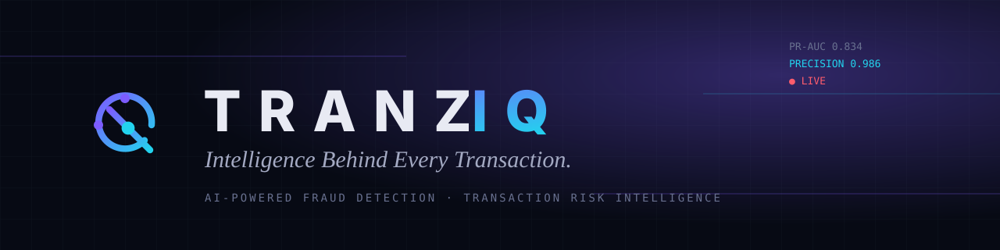
</p>

<p align="center">
  <b>AI-Powered Financial Fraud Detection & Transaction Risk Intelligence Platform</b><br>
  Logistic Regression · Random Forest · XGBoost · SMOTE · SHAP · FastAPI · React
</p>

<p align="center">
  
  
  
  
  
</p>

---

## 1. Introduction

**TRANZIQ** is an end-to-end machine-learning platform that detects potentially fraudulent credit-card
transactions. It trains three models on the real Kaggle *Credit Card Fraud Detection* dataset, compares
them honestly, explains every prediction with SHAP and puts everything in an interactive, art-directed
web application: a monitoring command center, a fraud scanner, a model laboratory, an investigation
workflow and more.

It opens with **"The Journey of a Transaction"**, an interactive, illustrated story that shows how fraud happens
and how TRANZIQ intervenes, and then moves into the monitoring platform.

Everything runs on your laptop: no cloud services, no paid APIs, no API keys.

### What's new in V2
- **Welcome experience**: a five-scene interactive story (bank → payments → fraud → TRANZIQ intervenes → welcome) with an
  "intelligence orbit" built from your real stored transactions.
- **Beginner-friendly scanner**: Quick Scan starts from a genuine labelled record (all 30 features), Advanced Scan
  shows the anonymised components in a collapsible panel, and CSV templates and sample files are included.
- **Chart interpretations** under every Model Lab graph, generated from the stored experiment metrics.
- **Unified Explorer**: one transaction list; the record origin is kept for auditing but out of the way.
- **Transaction Risk Decision Center**: separates "risk band" from "decision threshold", with clickable risk cards and a
  working **bulk re-apply** (one set-based SQL update; it also syncs alert severities).
- **XAI Studio**: auto-populated transaction lists, so you no longer type IDs.
- **Fraud Scenario Lab**: stress-tests the models with five scenarios, live threshold experiments and run comparison.
- **Branded 5-page PDF report** (ReportLab).
- **Two art-directed themes**: *Flashlight / Aubergine / Sandy Brown / Space Cadet* (dark) and
  *Italian Roast / Dried Plum / Parchment* (light), plus an ambient animated background and a circular-reveal theme switch.

> This is an educational portfolio project. Predictions are model outputs, not financial decisions.

## 2. Problem statement

Card fraud is rare: in the dataset only **0.167%** of transactions are fraudulent (about 599
legitimate transactions for every fraud). That creates three problems:

1. **Accuracy is misleading.** A model that never flags anything is already 99.8% accurate.
2. **Models ignore the rare class** unless the imbalance is handled deliberately.
3. **Decisions need explanations.** An analyst must know *why* a transaction was flagged.

## 3. Objectives

- Build a leak-free ML pipeline (split → scale → resample on training data only → train → tune → evaluate).
- Compare **Logistic Regression, Random Forest and XGBoost** under three imbalance strategies.
- Choose decision thresholds and the best model from **validation data**, then report on an untouched test set.
- Explain predictions with **SHAP** without inventing meanings for the anonymised features.
- Ship a usable product: REST API, SQLite persistence, alert investigation, synthetic data, exports, monitoring.

## 4. Architecture

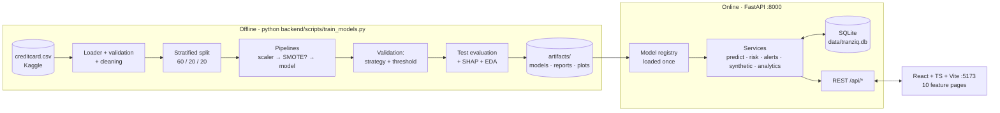

Models are trained **once**, saved with Joblib, and only *loaded* when the API starts.
Details: [docs/ARCHITECTURE.md](docs/ARCHITECTURE.md).

## 5. Technology stack

| Layer | Technology |
|---|---|
| Frontend | React 18, TypeScript, Vite, Tailwind CSS, Framer Motion, Recharts, Lucide icons |
| Backend | Python, FastAPI, Pydantic, SQLAlchemy 2 |
| Machine learning | pandas, NumPy, scikit-learn, XGBoost, imbalanced-learn (SMOTE), SHAP, Joblib |
| Database | SQLite |
| Static figures & reports | Matplotlib, Seaborn, ReportLab (PDF) |
| Testing | pytest, FastAPI TestClient, Playwright (UI smoke checks during development) |

## 6. Dataset source

**Credit Card Fraud Detection** by the Machine Learning Group, Université Libre de Bruxelles:
<https://www.kaggle.com/datasets/mlg-ulb/creditcardfraud>.

The 144 MB CSV is **not committed** to this repository. Get it with:

```bash
python backend/scripts/download_dataset.py
```

That script downloads the identical public copy used in the TensorFlow documentation and checks the row
count. Alternatively, download it from Kaggle (free account) and save it as `data/raw/creditcard.csv`.

## 7. Dataset explanation

| Column | Meaning |
|---|---|
| `Time` | Seconds elapsed since the first transaction in the dataset (covers ~48 hours) |
| `V1` … `V28` | **Anonymised** principal components (PCA) released by the dataset authors to protect cardholder privacy. Their real-world meaning is confidential, so TRANZIQ never interprets them. |
| `Amount` | Transaction amount |
| `Class` | Target: `1` = fraud, `0` = legitimate |

Measured on the file used here: **284,807 rows**, **1,081 exact duplicates** (removed), **0 missing
values**, **473 fraud rows after de-duplication (0.167%)**.

## 8. Data preprocessing

1. **Validation:** all 31 columns present, numeric, and `Class ∈ {0,1}`; otherwise a clear error.
2. **Cleaning:** drop rows with missing/infinite values or negative `Amount`/`Time`; drop exact
   duplicates so the same record can't appear in both training and test data.
3. **Stratified split** (seed 42): 60% train / 20% validation / 20% test, each with ~0.167% fraud.
4. **Scaling** inside the model pipeline: `RobustScaler` for the skewed `Amount`, `StandardScaler` for
   `Time` and V1–V28. Fitted on the training split only.

## 9. The class-imbalance problem

Three strategies were tested for every model:

| Strategy | What it does |
|---|---|
| `none` | Train on the data as-is |
| `class_weight` | Penalise mistakes on fraud more (`class_weight="balanced"`, XGBoost `scale_pos_weight`) |
| `smote` | Create synthetic fraud examples (to 10% of the majority) **inside the training pipeline only**; validation/test data are never resampled |

## 10. Machine-learning methodology

1. Train 3 models × 3 strategies = **9 experiments**, scored on the **validation** split by PR-AUC.
2. Keep each model's best strategy.
3. Choose each model's **decision threshold** on validation data by maximising F1.
4. Rank models by validation PR-AUC. **The winner is computed, not hard-coded.**
5. Evaluate the three final models **once** on the untouched test split.
6. Compute global SHAP importance and save everything to `artifacts/`.

Full write-up: [docs/ML_METHODOLOGY.md](docs/ML_METHODOLOGY.md).

## 11. Model comparison: real results

Held-out **test split** (56,746 transactions, 95 fraud) at each model's validation-chosen threshold.
These numbers come from an actual training run (`artifacts/reports/experiments.json`) and are
reproducible with seed 42.

| Rank | Model | Strategy | Threshold | **PR-AUC** | ROC-AUC | **Precision** | **Recall** | **F1** | Fraud caught | False alarms | Missed |
|---|---|---|---|---|---|---|---|---|---|---|---|
| 🥇 1 | **XGBoost** | none | 0.55 | **0.834** | 0.975 | **0.986** | 0.726 | **0.836** | 69 | 1 | 26 |
| 2 | Random Forest | none | 0.24 | 0.794 | 0.964 | 0.880 | **0.768** | 0.820 | 73 | 10 | 22 |
| 3 | Logistic Regression | none | 0.12 | 0.691 | 0.953 | 0.833 | 0.737 | 0.782 | 70 | 14 | 25 |

**What the imbalance experiment showed** (validation PR-AUC):

| | none | class_weight | SMOTE |
|---|---|---|---|
| Logistic Regression | **0.802** | 0.781 | 0.800 |
| Random Forest | **0.877** | 0.864 | 0.876 |
| XGBoost | **0.889** | 0.882 | 0.877 |

On this dataset, re-weighting and SMOTE did **not** improve PR-AUC; their main effect was shifting
probabilities upward (higher recall and lower precision at a fixed 0.5 cut-off). Because TRANZIQ tunes the
threshold afterwards, the unresampled models ranked best. That is a real finding, and the project
reports it rather than forcing SMOTE to "win".

## 12. Evaluation metrics

| Metric | Plain-English meaning |
|---|---|
| **Precision** | Of the transactions we flagged, how many were really fraud? (few false alarms) |
| **Recall** | Of all the real fraud, how much did we catch? (few missed frauds) |
| **F1-score** | One number balancing precision and recall |
| **PR-AUC** | Area under the precision-recall curve, the main score. It doesn't depend on a threshold and is honest under imbalance. |
| ROC-AUC | How well the model ranks fraud above legit (looks optimistic under imbalance) |
| Accuracy | Reported, but never used to choose models |
| Confusion matrix | Counts of TN / FP / FN / TP |

## 13. Feature overview

| # | Feature | What you can do |
|---|---|---|
| — | **Welcome story** | 5 scenes: everyday banking → payments → an unauthorised transaction → TRANZIQ intercepts it → *Welcome to TRANZIQ*. Auto-plays; pause/skip/arrow keys; find the suspicious signals in the orbit (optional). Reduced-motion users go straight to the welcome screen. |
| 01 | **Intelligence Command Center** | Live totals, predicted fraud rate, risk-distribution core, 24h activity timeline, recent alerts, monitoring stream, active-model performance |
| 02 | **Transaction Fraud Scanner** | **Quick Scan** from a real labelled sample (edit Amount/Time; the 28 components are kept), **Advanced Scan** with all 30 features, **Batch CSV** with template, sample file and downloadable predictions. Results: class, probability, risk, threshold, explanation, SHAP, next action. |
| 03 | **Model Comparison Laboratory** | Rankings, metric bars, PR & ROC curves, score separation, confusion matrices, threshold lab, imbalance experiment, hyper-parameters, each with a *"What this chart tells you"* panel generated from real results |
| 04 | **Transaction Intelligence Explorer** | One unified list; search, sort, paginate; filter by risk, prediction, known label, amount, probability, date, model; detail drawer; CSV export |
| 05 | **Transaction Risk Decision Center** | Simulator (gauge + band + threshold + class + action), "risk band vs decision threshold" explainer, clickable risk cards → Explorer, band editor with sliders + numeric inputs, **save & re-apply to stored data**, per-model thresholds |
| 06 | **Explainable AI Studio** | Global importance, SHAP beeswarm, official SHAP plot, auto-populated lists (highest risk / latest flagged / recent), waterfall, positive/negative drivers |
| 07 | **Fraud Scenario Lab** | Unusual spending · rapid activity · fraud-like patterns · legitimate patterns · custom. Real predictions, threshold experiment, run comparison, optional persistence as simulated data |
| 08 | **Fraud Alert & Investigation Center** | Severity queue, Pending → Investigating → Confirmed / Dismissed, analyst notes, persisted in SQLite |
| 09 | **Fraud Trends & Analytics** | Volume, fraud trend, probability distribution, amount analysis, hourly radar, weekday pattern, real-vs-simulated comparison, plus EDA of the real dataset |
| 10 | **Reports & Model Monitoring** | **DOWNLOAD PDF REPORT**, CSV / Markdown / JSON exports, health checks, model versions, prediction counts, dataset info |

**Data honesty rules:** every record keeps its origin (`kaggle` / `synthetic` / `user`) in the database for auditing.
Only historical Kaggle rows have a verified label; simulated and user records show **N/A**. Scenario data is never used
for training or evaluation, and alert statuses are stored as analyst decisions, never as labels.

## 14. Project structure

```
tranziq/
├── backend/
│   ├── ml/                  # dataset loader, EDA, preprocessing, models, evaluation, SHAP, synthetic, scenarios, train
│   ├── app/
│   │   ├── main.py          # FastAPI app, CORS, startup (load models, seed DB)
│   │   ├── config.py        # settings from .env
│   │   ├── database.py      # SQLAlchemy engine/session
│   │   ├── models.py        # ORM tables
│   │   ├── schemas.py       # Pydantic request validation
│   │   ├── services/        # prediction, risk, alerts, analytics, seeding, settings, model registry, pdf_report
│   │   └── api/             # routers: system, dashboard, transactions, predict, models, scenarios, synthetic, alerts, explain, reports
│   ├── scripts/             # download_dataset, train_models, seed_database, make_backup
│   └── tests/               # 83 pytest tests
├── frontend/
│   └── src/
│       ├── components/      # brand, layout, ambient background, theme switch, UI kit, visualisations
│       ├── lib/             # API client, types, hooks, theme context, chart insights, formatting
│       └── pages/           # Welcome story + the 10 feature pages
├── docs/                    # ARCHITECTURE, ML_METHODOLOGY, API_DOCUMENTATION, USER_GUIDE, screenshots
├── data/raw/                # put creditcard.csv here (git-ignored)
├── artifacts/               # generated by training (git-ignored)
├── requirements.txt  ·  .env.example  ·  setup_project.bat  ·  run_project.bat
└── DEVELOPMENT_PROGRESS.md
```

## 15. Installation (Windows)

**Prerequisites:** [Python 3.11–3.13](https://www.python.org/downloads/) (tick *Add to PATH*),
[Node.js 18+](https://nodejs.org/), [Git](https://git-scm.com/), VS Code.

**Option A: one click.** Double-click `setup_project.bat`, or in the VS Code PowerShell terminal type
`.\setup_project.bat` (PowerShell needs the `.\` prefix to run a script from the current folder). It creates `.venv`, installs Python and npm
packages, downloads the dataset and trains the models (~3–10 minutes).

**Option B: step by step.** Run these in the VS Code terminal (PowerShell or Command Prompt), from the
project folder.

Create the virtual environment:

```bash
python -m venv .venv
```

Activate it (in PowerShell use `.venv\Scripts\Activate.ps1` instead):

```bash
.venv\Scripts\activate
```

Install the Python packages:

```bash
pip install -r requirements.txt
```

Install the frontend packages (then return to the project folder with `cd ..`):

```bash
cd frontend
```

```bash
npm install
```

Get the dataset:

```bash
python backend\scripts\download_dataset.py
```

Train the models:

```bash
python backend\scripts\train_models.py
```

Use `--quick` for a ~30-second smoke run on 10% of the legitimate rows.

## 16. Running

**One click:** double-click `run_project.bat` (or type `.\run_project.bat` in PowerShell). It opens two windows (API and web) and your browser at
<http://localhost:5173>.

**Manually, in two VS Code terminals.** Terminal 1 starts the API. Go into the backend folder:

```bash
cd backend
```

Then start the API:

```bash
..\.venv\Scripts\uvicorn app.main:app --reload --port 8000
```

Terminal 2 starts the web app. Go into the frontend folder:

```bash
cd frontend
```

Then start the web app:

```bash
npm run dev
```

**Inside VS Code:** *Terminal → Run Task… → "TRANZIQ: Start everything"*.

| URL | What |
|---|---|
| <http://localhost:5173> | TRANZIQ web application |
| <http://localhost:8000/docs> | Interactive API documentation (Swagger) |
| <http://localhost:8000/api/health> | Health check |

On first start, the API fills `data/tranziq.db` with **all fraud rows + 4,000 random legitimate rows from
the held-out test split** (so stored predictions are genuine out-of-sample predictions) and 300 synthetic
transactions. Fraud is deliberately over-represented in this demo sample, and the UI says so.

**Run the tests** (from the `backend` folder):

```bash
..\.venv\Scripts\python -m pytest
```

**Create a verified ZIP backup** (written to `backups/`, which is git-ignored):

```bash
python backend\scripts\make_backup.py
```

## 17. API documentation

| Method | Endpoint | Purpose |
|---|---|---|
| GET | `/api/health` | Health & readiness |
| GET | `/api/dashboard/summary` | Command Center data |
| GET | `/api/transactions` | Search / filter / sort / paginate |
| GET | `/api/transactions/{id}` | Transaction detail (+ all model predictions) |
| POST | `/api/predict` | Single prediction (+ SHAP) |
| POST | `/api/predict/batch` | Batch prediction (JSON) |
| POST | `/api/predict/upload` | Batch prediction (CSV upload) |
| GET | `/api/models` · `/api/models/metrics` · `/api/models/comparison` | Model registry & evaluation |
| GET | `/api/models/{name}/threshold-analysis` | Evaluate any threshold on the test split |
| GET | `/api/analytics/trends` | Trend analytics |
| POST / DELETE | `/api/synthetic/generate` · `/api/synthetic` | Generate / reset synthetic data |
| GET / PATCH | `/api/alerts` · `/api/alerts/{id}` | Alert queue & analyst decisions |
| GET | `/api/explain/{transaction_id}` · `/api/explain/global` | SHAP explanations |
| GET / PUT | `/api/settings` · `/api/risk/levels` | Active model, risk bands, thresholds |
| GET | `/api/reports/transactions.csv` · `/api/reports/evaluation` | Exports |
| GET | `/api/reports/pdf` | Branded 5-page PDF report |
| POST | `/api/risk/reapply` | Validate + save bands and re-classify every stored prediction |
| GET / POST | `/api/scenarios/catalog` · `/api/scenarios/run` | Fraud Scenario Lab |
| GET | `/api/predict/template.csv?samples=n` | CSV template / sample file for the scanner |

Full reference with examples: [docs/API_DOCUMENTATION.md](docs/API_DOCUMENTATION.md).

## 18. Screenshots

| | |
|---|---|
| 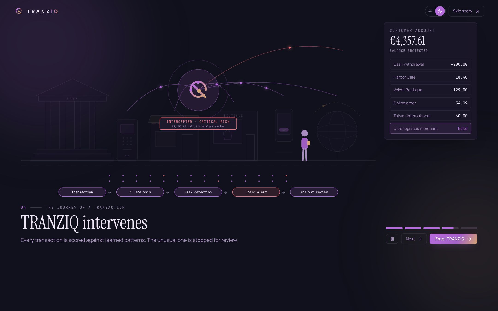 The Journey of a Transaction · scene 4 | 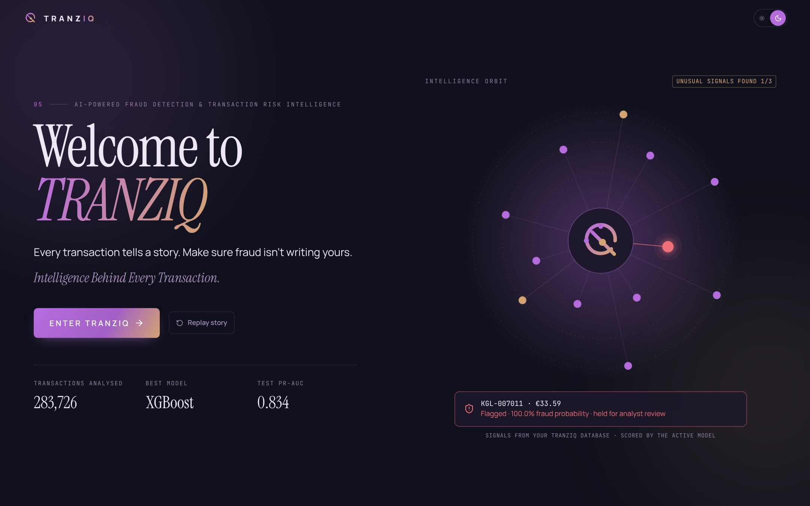 Welcome + intelligence orbit (live data) |
| 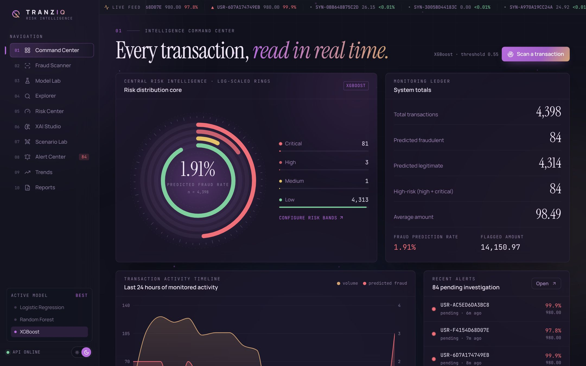 01 · Command Center (dark) | 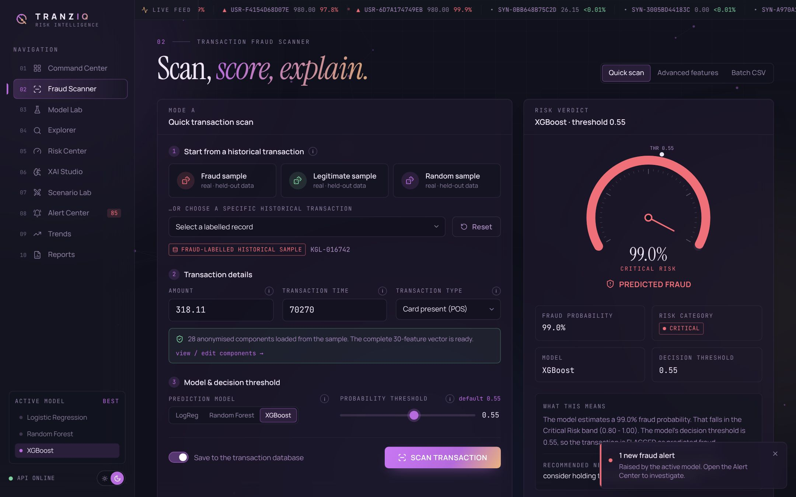 02 · Quick Scan of a real fraud-labelled record |
| 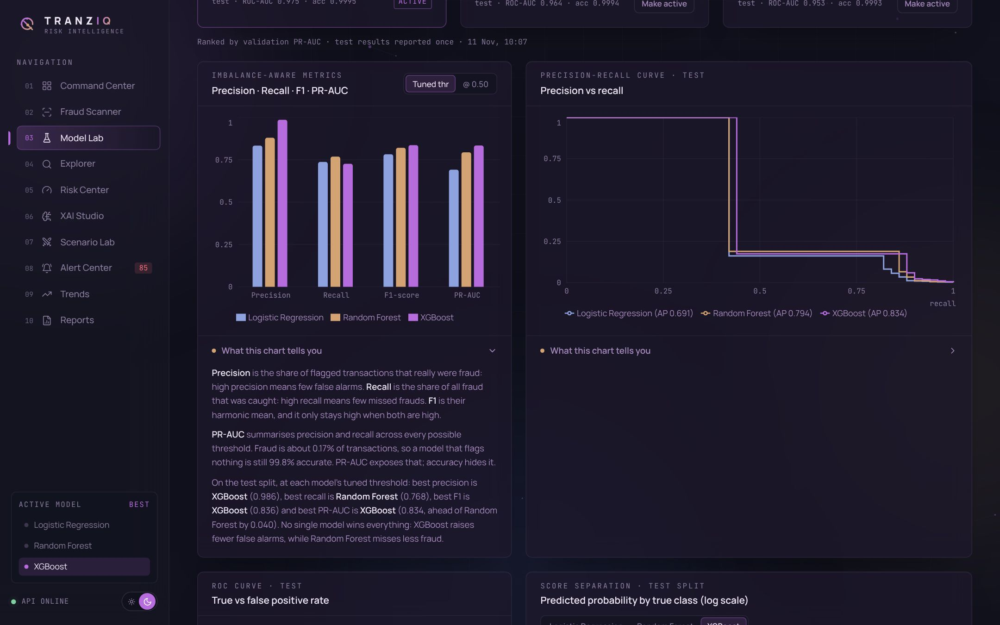 03 · Model Lab with generated interpretation | 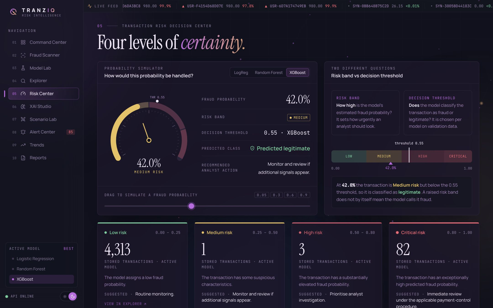 05 · Risk Decision Center |
| 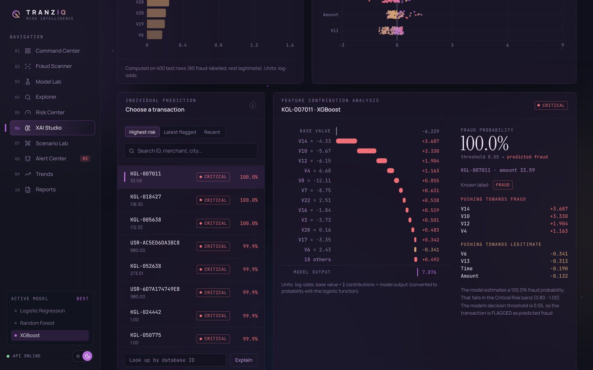 06 · XAI Studio | 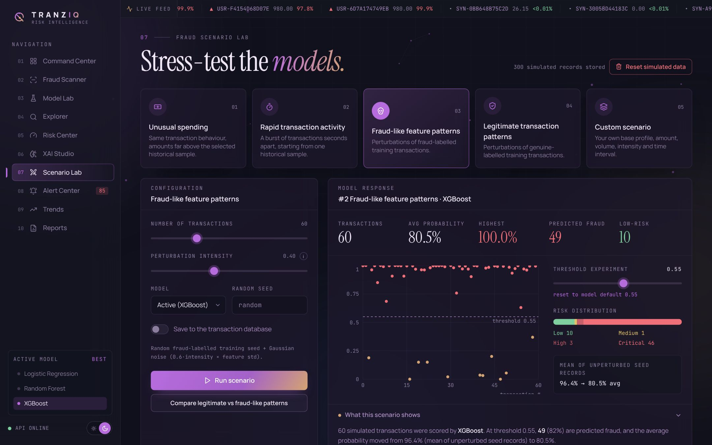 07 · Scenario Lab comparison |
| 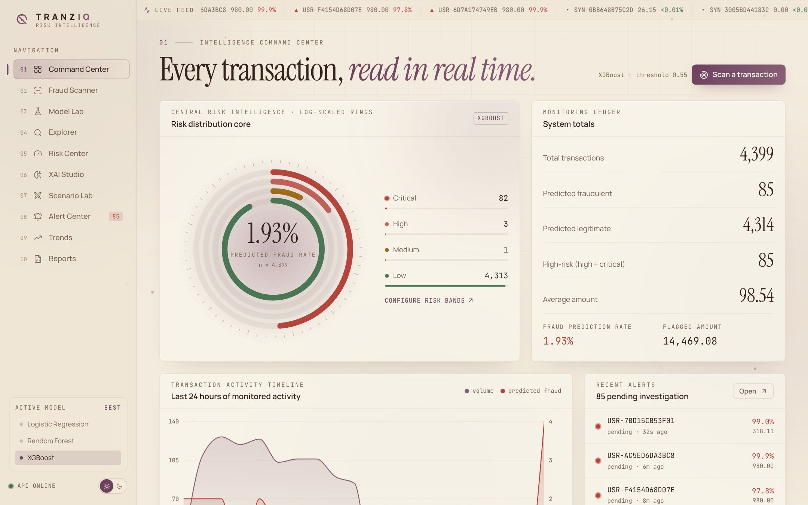 Light theme · Italian Roast / Dried Plum / Parchment | 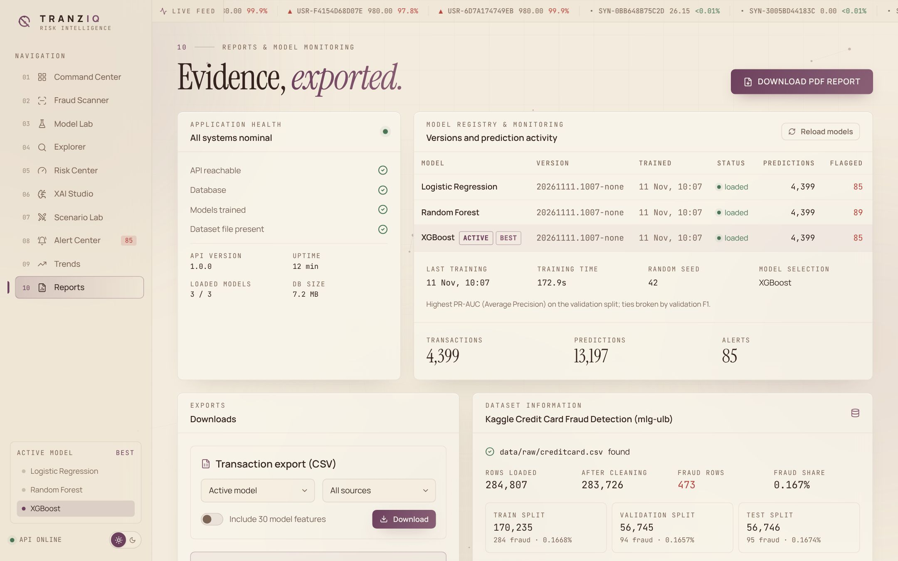 10 · Reports & PDF export |


## 19. Future improvements

- Hyper-parameter search (Optuna) with time-aware cross-validation.
- Probability calibration (Platt / isotonic) and cost-sensitive threshold selection.
- Drift monitoring (PSI) and scheduled retraining with a model registry.
- Feedback loop: use confirmed analyst decisions as a separate, versioned labelled set.
- Authentication & roles; PostgreSQL; Docker image for deployment.
- Graph features (customer–merchant networks) on datasets that include identifiers.

---

<p align="center"><sub>TRANZIQ · Intelligence Behind Every Transaction. · Educational portfolio project. Dataset © ULB Machine Learning Group (Open Database License).</sub></p>
