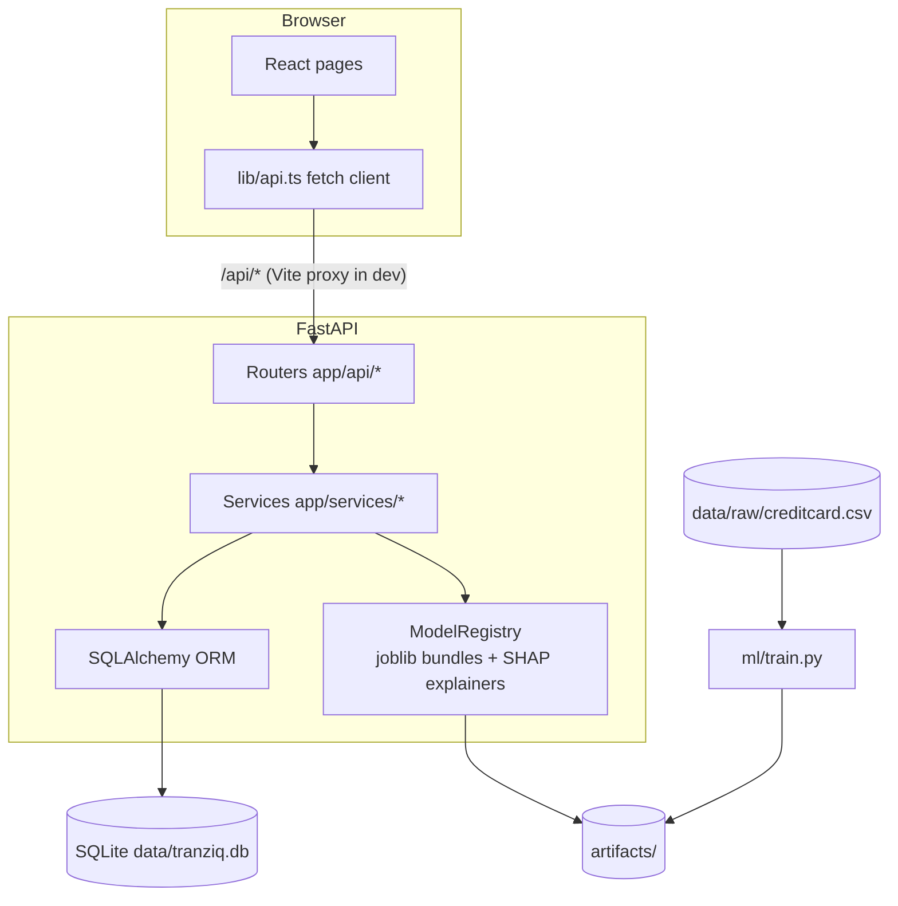
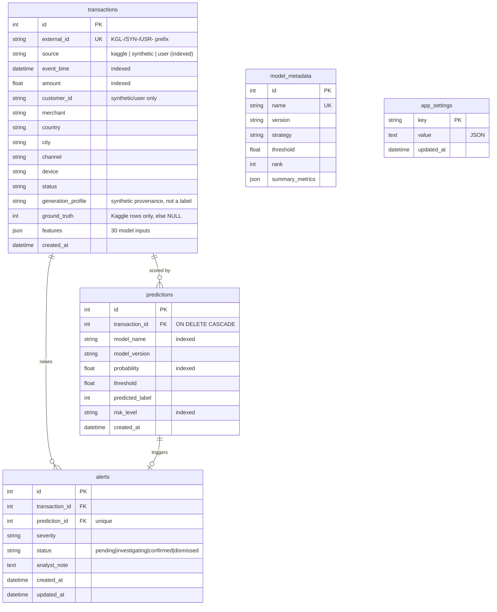

# TRANZIQ: Architecture

*Intelligence Behind Every Transaction.*

## 1. Big picture

TRANZIQ has three layers that run separately:

| Layer | Folder | Runs when | Job |
|---|---|---|---|
| **ML pipeline** | `backend/ml/` | Once, via `train_models.py` | Turns the Kaggle CSV into trained models, metrics, SHAP values and figures in `artifacts/` |
| **API** | `backend/app/` | `uvicorn app.main:app` (port 8000) | Loads the saved models, stores transactions/predictions/alerts in SQLite, serves JSON |
| **Web app** | `frontend/` | `npm run dev` (port 5173) | The TRANZIQ interface; talks to the API only over HTTP |

> **Why separate training from serving?** Training takes minutes and must be reproducible. Serving
> must start in seconds. The API therefore only *loads* `artifacts/models/*.joblib` and never retrains on
> start-up.

## 2. Backend modules

### `backend/ml/` (machine learning)
| File | Responsibility |
|---|---|
| `config.py` | Paths, random seed, split sizes, SMOTE settings, model names |
| `data_loader.py` | Load CSV, validate schema, clean (missing/invalid/duplicates), statistics |
| `preprocessing.py` | Stratified split, `ColumnTransformer` scaler, `imblearn.Pipeline` builder |
| `models.py` | Model factory + documented hyper-parameters per imbalance strategy |
| `evaluation.py` | Metrics, curves, threshold table, F1-optimal threshold search |
| `eda.py` | EDA statistics (JSON for the UI) and Matplotlib/Seaborn PNGs |
| `explain.py` | SHAP explainers (Tree/Linear), local & global explanations |
| `synthetic.py` | Synthetic transaction engine (perturbation of training records + metadata) |
| `scenarios.py` | Fraud Scenario Lab: five documented perturbation scenarios producing model-compatible vectors |
| `train.py` | Orchestrates the 9 experiments, selection, test evaluation, saving |

### `backend/app/` (web API)
| File / folder | Responsibility |
|---|---|
| `main.py` | App factory, CORS, router registration, static plots, start-up (create tables → load models → seed) |
| `config.py` | Settings from environment / `.env` |
| `database.py` | Engine (SQLite with foreign keys + WAL), session dependency |
| `models.py` | ORM tables |
| `schemas.py` | Pydantic validation of request bodies |
| `services/model_registry.py` | Loads bundles once, caches SHAP explainers and test-set probabilities |
| `services/prediction_service.py` | Scores, stores predictions, raises alerts, validates CSV uploads |
| `services/risk.py` | Four-level risk classification + explanations |
| `services/settings_service.py` | Active model, risk bands, threshold overrides (persisted) |
| `services/transaction_service.py` | Explorer query builder (filters, sort, paging) |
| `services/alert_service.py` | Alert queue and analyst decisions |
| `services/analytics_service.py` | Dashboard and trend aggregations (pandas over SQL results) |
| `services/seed_service.py` | First-start seeding + model metadata sync |
| `services/pdf_report.py` | ReportLab + Matplotlib branded PDF (two-pass canvas for "Page X of Y") |
| `api/*.py` | Thin HTTP routers that call services |

## 3. Database design (SQLite)

Design notes:
- **No duplication:** a transaction's features are stored once; each model's opinion is a separate
  `predictions` row (a composite index on `model_name, transaction_id` makes "latest prediction per
  model" fast).
- **Ground truth vs predictions vs decisions** are three different columns in three different tables,
  so they can never be confused.
- Every stored transaction is scored by **all three** models. Alerts come only from the **active**
  model, so one transaction can't raise three alerts.

## 4. Request flow example: scanning a transaction

1. The user presses **Run fraud scan**. The frontend `POST`s `/api/predict` with 30 features.
2. Pydantic (`PredictRequest`) rejects missing, unknown, non-finite or negative values with **422**.
3. `prediction_service.predict_single` runs the selected pipeline (`scaler → model`) to get a probability.
4. `risk.explain_level` maps the probability to a band and compares it with the decision threshold.
5. `ModelRegistry.explain` computes SHAP values for this one row.
6. If *persist* is on, the transaction is stored as `source=user`, scored by every model, and an alert is
   raised if the active model flags it or rates it High/Critical.
7. JSON goes back to the UI. The risk meter, verdict and SHAP bars animate in.

## 5. Frontend structure

| Folder | Content |
|---|---|
| `src/components/Brand.tsx` | The "Signal Q" symbol and wordmark |
| `src/components/Layout.tsx` | Index-rail navigation, live ticker, alert watcher + floating notifications, mobile drawer, page transitions |
| `src/pages/Welcome.tsx` | "The Journey of a Transaction": 4 SVG story scenes + welcome screen with an interactive orbit of real transactions; shown once per session |
| `src/components/Ambient.tsx` | Canvas background: drifting nodes, network links, travelling signals (≤30 fps, paused when hidden, static for reduced motion) |
| `src/components/ThemeSwitch.tsx` | Animated theme toggle; circular reveal via the View Transitions API with fallback |
| `src/lib/insights.tsx` | Generates Model Lab chart interpretations from the stored metrics |
| `src/components/ui.tsx` | Panels, editorial page headers, chips, animated numbers, segmented controls, drawer, dialogs, chart tooltip |
| `src/components/viz.tsx` | Risk meter gauge, risk-distribution core, SHAP bars, confusion matrix |
| `src/lib/` | Typed API client, data hook with polling, theme/settings/toast context, chart colour resolver |
| `src/pages/` | One file per feature page |

**Theming:** colours are CSS variables (`--violet`, `--coral`…) in `styles/index.css`, defined twice
(dark midnight navy, light warm off-white). Tailwind classes such as `bg-panel` point at them, so every
component switches theme automatically. Recharts needs literal colours, so `useChartColors()` reads the
variables whenever the theme changes. The choice is saved in `localStorage`.

**Motion:** Framer Motion with `MotionConfig reducedMotion="user"`, plus a CSS
`prefers-reduced-motion` override, so the OS accessibility setting disables non-essential animation.

## 6. Configuration & security

- All configuration is optional (`.env.example`); there are **no secrets or API keys**.
- CORS allows only the local frontend origins by default.
- CSV uploads are size-limited (25 MB, 5,000 rows) and validated row by row.
- `.env`, the dataset, the database, models and backups are git-ignored.
